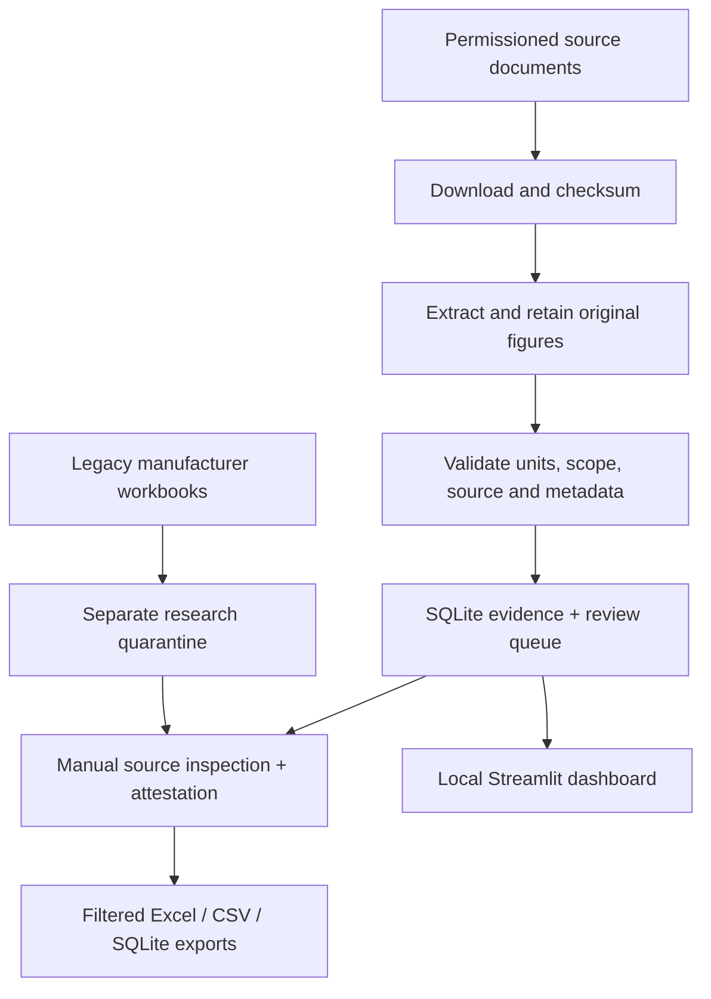

# GCC — recovered project history and system design

Date: 2026-11-11. This document synthesizes the project context available in
this chat, saved GCC/COS files and the GitHub `GCC-COS` repository. It is not a
verbatim export of every historical ChatGPT or Codex session. The Git history
is preserved; off-repository Windows/VS Code folders are not remotely visible.

## Purpose and users

The **Green Carbon Corridor (GCC)** initiative is developing a **Carbon
Operating System (COS)** for public users, industry, and an initial Smart City
client. The requested capabilities are evidence-backed footprint measurement,
sector comparison, mitigation planning, scenario analysis, and progress tracking.
The starting pilot is cement, with future steel, glass, electronics, transport
and city activity coverage. Full-city digital twins, prediction, carbon credits,
and facility-specific emissions remain planned scope, **not** demonstrated
capabilities of this repository.

## Chronology reconstructed from available project context

| Period | Work / decision | Evidence status |
| --- | --- | --- |
| Early October 2026 | GCC/COS objectives, paper structure, lifecycle emissions, carbon-credit types | Conversation-derived brief |
| 9–12 October | HS 2022 six-digit classification workbook with 5,613 codes; expanded units and first Colab/SQLite automation plans | Saved workbook; historical factors are indicative screening estimates, not verified |
| Mid to late October | Original-data preference, source provenance, cement pilot, validation queue, Python/VS Code and CMD tools | Saved plans and early tool archives |
| 30–31 October | Phase 1–4 `GCC-COS` Git work: collection, normalization, audit, human review, Streamlit dashboard, CI/tests | Git history and test suite recovered |
| 2–6 November | GCC website/social/presentation/voiceover material and Windows export troubleshooting | Saved assets and chat context; no automatic claim they all run in this repository |
| 10 November | Apple, Samsung, Google and cross-company product footprint workbooks, plus manual manufacturer research checkpoint | Saved workbooks, not independently verified source documents |
| 11 November | Consolidation into this system; strict research staging, duplicate/conflict review, archive catalog | This consolidation snapshot |

## Runtime architecture

- `gcc_cos/`: existing CLI, source mapping, guarded downloads, ingestion,
  provenance, validation, review and export.
- `dashboard.py`: local Streamlit inspection; no public authentication.
- `config/`: source registry and the intentionally empty automatic HS rule set.
- `examples/`: attributed pinned source fixtures and historical phase reports.
- `research/`: counts-only summary of the newer company/model extraction,
  **not trusted production input**; the rows are not stored in the repository.
- `archive/legacy/`: original source trees from earlier Windows tool ZIPs.
- `tests/`: synthetic and real-source regression tests.

## Data categories must never be mixed

| Kind | Example | Correct interpretation |
| --- | --- | --- |
| Product lifecycle footprint | kg CO₂e per specific phone configuration | Model, region, lifetime and boundary matter |
| Product material factor | kg CO₂e per kg of material, EPD A1–A3 | Not full product lifecycle; retain declared unit |
| Activity emission factor | kg CO₂e per kWh or transport activity | Not automatically product-level |
| National inventory | Annual cement-process tonnes CO₂ | Not per tonne cement |
| Screening estimate | Legacy HS6 indicative factor | Not approved/verified; demonstration only |
| Avoided emissions / credits | Project-specific mitigation claim | Requires methodology, baseline, additionality and external validation |

## Current implementation truth

The inherited Git README documents 1,241 source-reported observations across
the original phases, all retaining their own statuses and boundaries. Those
numbers are **source observations**, not independently verified items or a
promise of current live-source coverage. Its Phase 4 verified-only export was
empty because original-publisher review was not completed. The newer 4,146
research rows are additional observations and overlapping candidates, not
4,146 verified unique SKUs. No automatic union is performed.

## Next build priorities

1. Secure original publisher evidence and record licensing/independent checks.
2. Work the duplicate/conflicting research queue; retain configuration-level
   distinctions and original values.
3. Build official HS2022/HS2027 and Pakistan tariff classification references
   with a human-controlled edition-aware mapping process.
4. Collect cement plant activity data and create a boundary-aware pilot with
   local context and uncertainty; do not use HS screening estimates as reality.
5. Only then add a vetted mitigation planner, Smart City workflows, API and
   multi-user security. Digital-twin/3D views are a presentation layer, not a
   substitute for measured emissions.
